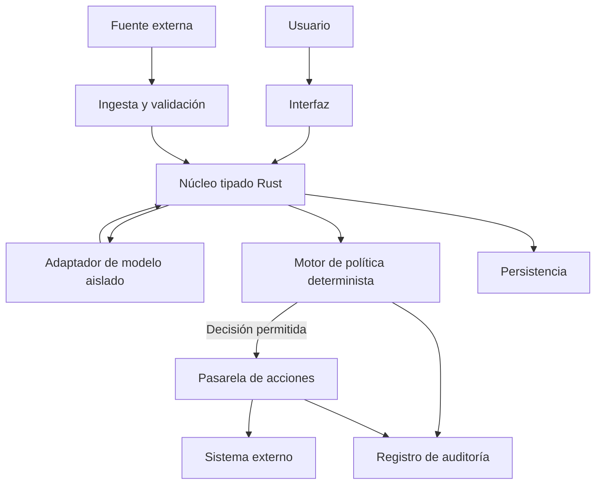

# Flujos de datos (DFD) y límites de confianza — v0

**Estado: PROPUESTO.** Este esquema representa una arquitectura candidata, no componentes ejecutándose.

## Fronteras y entradas
| Frontera | Datos no confiables | Validación exigida |
|---|---|---|
| TB-01 Usuario → UI | texto, archivos, identidad declarada | autenticación cuando aplique, límites de tamaño, esquema |
| TB-02 Fuente → Ingesta | documentos, sensores, URLs | procedencia, parsing seguro, cuotas, rechazo de contenido activo |
| TB-03 Modelo → Núcleo | respuestas y llamadas propuestas | estructura tipada, tamaño, sin autoridad implícita |
| TB-04 Núcleo → Política | actor, recurso, intención | vincular identidad, contexto y alcance |
| TB-05 Política → Acción | decisión y argumentos | revalidación, expiración, idempotencia |
| TB-06 Núcleo → Almacén | eventos y metadatos | esquema, minimización, integridad, retención |
| TB-07 Nodo → Nodo | mensajes federados futuros | autenticación mutua, replay, límites, aún no diseñado |
| TB-08 Build → Binario | compilador, crates, scripts | procedencia, revisión, aislamiento de CI |

## Datos y secretos
Nunca introducir credenciales en prompts o logs; separar secretos de datos de entrenamiento, evidencia y ejemplos. No usar datos personales reales en los tests.

## Pendientes
DFD de despliegue concreto, amenazas por componente, límites de recursos, formatos y decisiones de persistencia. Ningún aislamiento ha sido medido.
